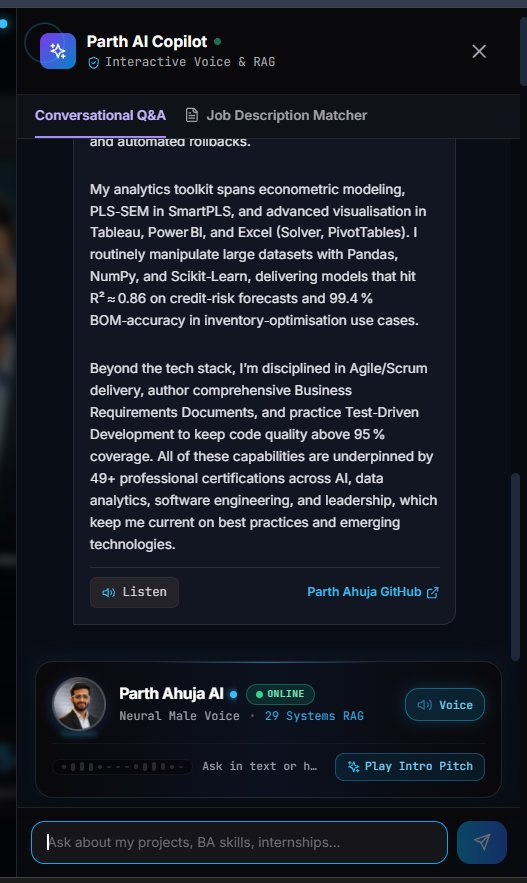
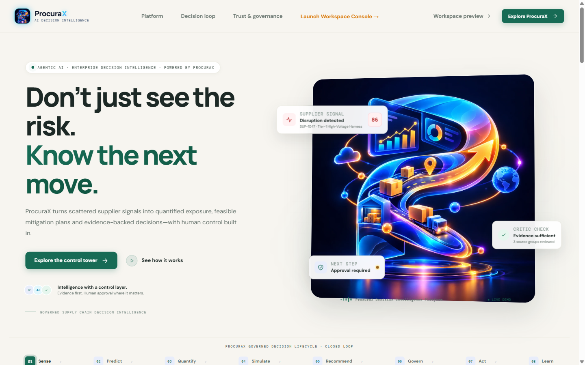
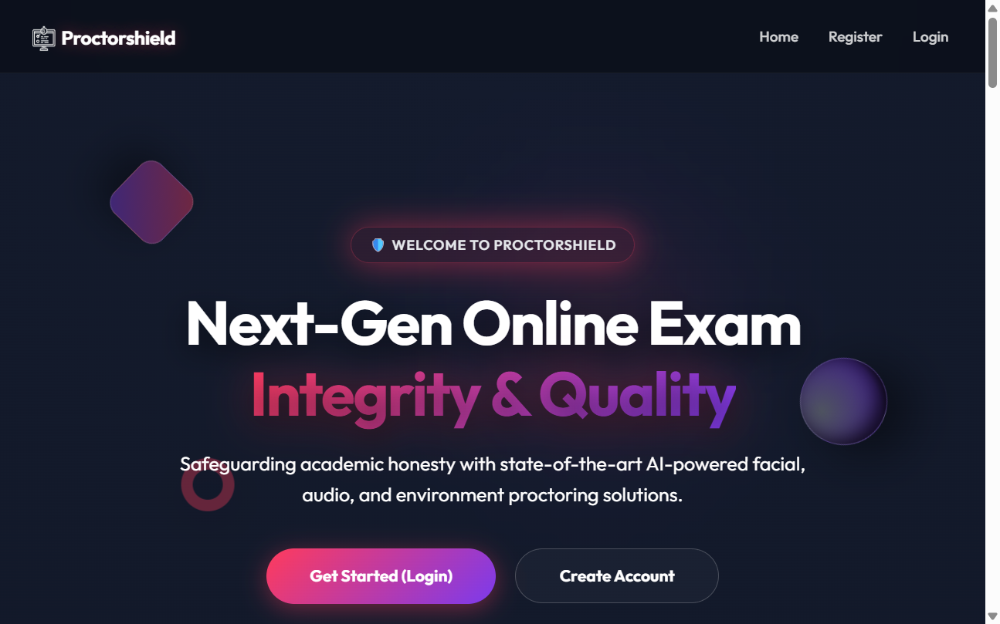
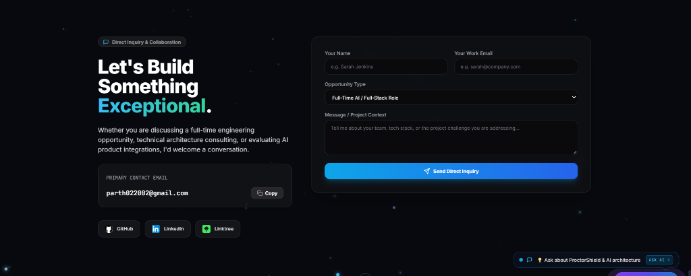
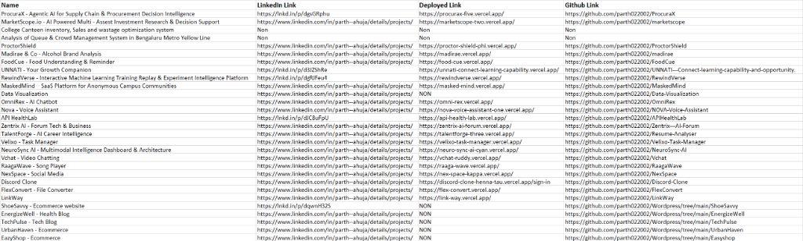
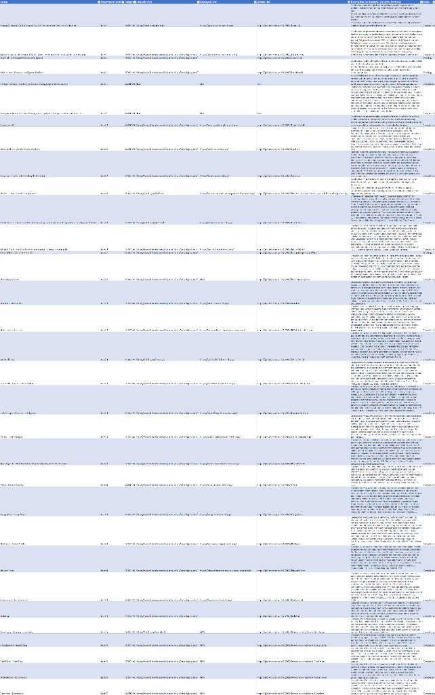
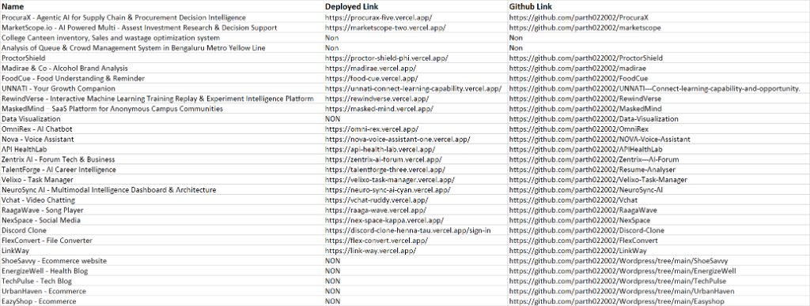
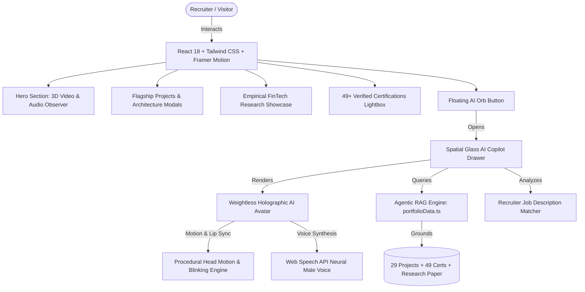

# 🚀 Parth Ahuja — Interactive AI Engineering & Business Analytics Portfolio

[](https://react.dev/)
[](https://www.typescriptlang.org/)
[](https://vitejs.dev/)
[](https://tailwindcss.com/)
[](https://www.framer.com/motion/)
[](https://vercel.com/)
[](LICENSE)

> **Architecting High-Impact AI Systems, Scalable Web Platforms, and High-ROI Digital Products.**  
> A hyper-modern, interactive portfolio featuring an **on-device Agentic RAG AI Copilot**, **spatial 3D video presenter**, **weightless floating holographic AI avatar**, **recruiter job-description analyzer**, and **empirical FinTech research** — bridging computer engineering rigor with corporate business analytics strategy.

---

## 📌 Table of Contents

- [👤 About Parth Ahuja](#-about-parth-ahuja)
- [✨ Key Portfolio Innovations & Features](#-key-portfolio-innovations--features)
  - [1. Spatial 3D Video Presenter (Hero Section)](#1-spatial-3d-video-presenter-hero-section)
  - [2. Weightless Floating Holographic AI Avatar](#2-weightless-floating-holographic-ai-avatar)
  - [3. Agentic RAG Copilot with Male Neural Voice](#3-agentic-rag-copilot-with-male-neural-voice)
  - [4. Multi-Tier Orbiting Floating AI Button](#4-multi-tier-orbiting-floating-ai-button)
  - [5. Recruiter Job Description Matcher](#5-recruiter-job-description-matcher)
  - [6. Flagship Projects Showcase & Architecture Modals](#6-flagship-projects-showcase--architecture-modals)
  - [7. Empirical FinTech Research Deep-Dive (PLS-SEM)](#7-empirical-fintech-research-deep-dive-pls-sem)
  - [8. Verified 49+ Certifications Matrix](#8-verified-49-certifications-matrix)
  - [9. Skills Constellation & 100 Ranked Competencies](#9-skills-constellation--100-ranked-competencies)
- [📸 Visual Showcase & Screenshots](#-visual-showcase--screenshots)
- [🛠️ Tech Stack & Architectural Flow](#️-tech-stack--architectural-flow)
- [📂 Directory Structure](#-directory-structure)
- [🚀 Quick Start & Local Development](#-quick-start--local-development)
- [📬 Connect with Parth](#-connect-with-parth)

---

## 👤 About Parth Ahuja

I am a **Full-Stack AI Engineer & Business Analytics Strategist** currently pursuing my **Post Graduate Diploma in Management (PGDM - Business Analytics)** at the prestigious **Jagdish Sheth School of Management (JAGSoM), Bengaluru** (Class of 2027), holding a prior **Bachelor of Engineering in Computer Science** (Graduated with Distinction, 2020–2024).

My work uniquely converges **hardcore engineering execution** (computer vision, multi-agent AI architectures, RAG pipelines, WebRTC) with **rigorous business acumen** (econometric modeling, structural equation modeling in SmartPLS, demand forecasting, KPI dashboards, and supply chain optimization).

### 📊 By The Numbers

| Metric | Count | Details |
| :--- | :---: | :--- |
| **Engineering Systems Built** | **29** | Production platforms, research prototypes, and full-stack solutions |
| **Industry Certifications** | **49+** | Verified credentials across IBM, Google, Microsoft, Intel, freeCodeCamp |
| **Ranked Core Competencies** | **100** | Data-ranked skills cross-referenced with real project proof-counts |
| **Published Research Papers** | **1** | Empirical study on AI advisory adoption (*N = 211*, *R² = 0.856*, PLS-SEM) |
| **Code Repositories** | **25+** | Open-source systems spanning AI, Full-Stack, and Cloud architectures |

---

## ✨ Key Portfolio Innovations & Features

### 1. Spatial 3D Video Presenter (Hero Section)
- **3D Cursor-Tracked Physics**: The hero video card tracks mouse position in real-time to compute 3D tilt (`perspective: 1000px`, `rotateX`, `rotateY`).
- **Autonomous Scroll-Based Audio Observer**: Utilizing an `IntersectionObserver`, the video automatically mutes when scrolled out of view (< 35% visible) and seamlessly resumes user-selected audio when returning to the hero section.
- **Mobile-First Hierarchy**: The video presenter is prioritized at the top on phone screens (`order-1` video, `order-2` text) before the punchy, 50% reduced executive bio statement.

### 2. Weightless Floating Holographic AI Avatar
- **Zero-Card Levitation Design**: Removed rectangular card frames and dark wireframe boxes in favor of a spatial floating holographic orb.
- **Lifelike Procedural Animation**:
  - Continuous vertical zero-gravity levitation (`bobY`) and conversational nodding (`pitchX`) on speech emphasis beats.
  - Natural human eye blinking every ~3.5 to 6 seconds.
  - Dynamic lip and jaw cadence synchronized to synthesized speech amplitude.
- **Fluid Siri/Gemini Soundwave Ribbon**: Multi-frequency spectrum visualizer indicating idle, thinking, and speaking states.
- **1-Click Executive Pitch**: Direct `Pitch` button delivering a concise 30-second first-person introduction of Parth's profile and technical stack.

### 3. Agentic RAG Copilot with Male Neural Voice
- **Locally Grounded Retrieval Engine**: Direct vector-like retrieval over Parth's 29 engineering systems, JAGSoM business analytics curriculum, empirical research paper, and 49+ certifications.
- **Authentic First-Person Human Voice**: Engineered to reply in an authoritative yet approachable executive voice (*"I built...", "My focus was...", "Across my work..."*) eliminating robotic bulleted headers.
- **Web Speech API with Resume Guard**: Configured with a natural male neural voice, phonetic acronym expansion (*JAGSoM*, *PLS-SEM*, *RAG*), and automatic browser pause/resume unlock guards.

### 4. Multi-Tier Orbiting Floating AI Button
- **Circular Orb Form-Factor**: Replaced the previous elongated button with a circular floating orb highlighting the AI Sparkles glyph.
- **Multi-Layered Motion Choreography**:
  - Continuous 360° chromatic light aura ring (`conic-gradient(from 0deg, #38bdf8, #818cf8, #c084fc, #f472b6, #38bdf8)`).
  - Concentric acoustic radar shockwaves (`animate-ping`).
  - Elliptical orbiting satellite micro-star with ambient glow.
  - Top-right live emerald jewel indicator (`bg-emerald-400 animate-pulse`).
  - Rotating prompt suggestion bubble aligned with the circular button.

### 5. Recruiter Job Description Matcher
- **Interactive Recruiter Evaluation Tab**: Recruiters can paste raw job descriptions (e.g., Business Analyst, AI Engineer, Full-Stack Developer).
- **Instant Match Scoring**: Evaluates keyword overlaps against Parth's 100 competencies, calculating an alignment percentage score and recommending the most relevant projects.

### 6. Flagship Projects Showcase & Architecture Modals
- **Curated 3-Item Layout with Expansion**: Projects initially display the top 3 curated highlights with a smooth "See More / Show Less" toggle.
- **Deep-Dive Engineering Modals**: Each modal unpacks the **Problem Statement**, **Technical Architecture**, **Measurable Business Impact**, **Key Performance Metrics**, and direct links to live deployments and GitHub repositories.
- **Interactive Categories**: Filters across *AI & GenAI*, *Full Stack*, *Data & Real-Time*, *E-Commerce*, and *Business Analytics & Strategy*.

### 7. Empirical FinTech Research Deep-Dive (PLS-SEM)
- **Paper**: *"Understanding AI Advisory Adoption Among Indian Retail Investors: Evidence From Trust, Social Influence, and Risk Perceptions"*.
- **Rigorous Methodology**: Structural Equation Modeling (PLS-SEM with 5,000 bootstrap resamples) across *N = 211* retail investors.
- **Breakthrough Findings**:
  - Social Influence is the primary adoption driver ($\beta = 0.489, p < 0.001$).
  - Trust acts as an $80.5\%$ full mediator between Perceived Usefulness and Adoption.
  - Substantial explanatory power ($R^2 = 85.6\%$), significantly outperforming prior literature benchmarks.
  - In-browser interactive stat cards and direct PDF download link.

### 8. Verified 49+ Certifications Matrix
- **Credential Showcase**: Certifications from IBM, Google, Microsoft Learn, Intel, freeCodeCamp, and academic bodies.
- **Interactive Lightbox Modal**: View full verification certificates with keyboard `Escape` key and backdrop click-to-close listeners.

### 9. Skills Constellation & 100 Ranked Competencies
- Six core domains: *Business Analysis & Product Strategy*, *Data Analytics & BI*, *Generative AI & ML*, *Full-Stack Engineering*, *Databases & Cloud*, and *Operations & Supply Chain*.
- Cross-references each competency with verified project proof counts.

---

## 📸 Visual Showcase & Screenshots

### 🌟 Hero Section & 3D Spatial Video Presenter

*Spatial 3D cursor-tracking video card with mobile-first layout and punchy executive bio statement.*

---

### 🤖 Floating Spatial AI Presenter & Agentic Copilot
| Weightless Spatial AI Copilot | ProcuraX Agentic AI Platform |
| :---: | :---: |
|  |  |
| *Frosted-glass Copilot with male neural voice and RAG answers.* | *Multi-agent supply chain intelligence platform.* |

---

### 🛡️ Flagship Project Architecture & Detailed Modals
| ProctorShield Examination Vision | Deep-Dive Architecture Modal |
| :---: | :---: |
|  |  |
| *Real-time facial mesh, gaze tracking & acoustic monitoring.* | *Architecture breakdown, business impact & key metrics.* |

---

### 📈 Empirical Research & 49+ Verified Certifications
| FinTech Empirical Research Paper (PLS-SEM) | 49+ Verified Credentials Matrix |
| :---: | :---: |
|  |  |
| *Empirical model achieving $R^2 = 85.6\%$ on AI advisory adoption.* | *Interactive credential grid with lightbox modal inspection.* |

---

### 🌌 100 Ranked Competencies & Skills Constellation

*Categorized competency taxonomy cross-referenced against 29 engineering deployments.*

---

## 🛠️ Tech Stack & Architectural Flow



### Core Technologies

| Layer | Technologies |
| :--- | :--- |
| **Frontend Core** | **React 18**, **TypeScript 5.5**, **Vite 5.4** |
| **Styling & Theme** | **Tailwind CSS 3.4**, Custom Glassmorphic Utilities, Dark Theme |
| **Motion & Spatial Physics** | **Framer Motion 12.38**, Custom 3D Tilt Algorithms, Procedural Levitation |
| **AI & Voice Services** | Local RAG Pipeline, **Web Speech API**, **Web Audio API** Spectrum Analyser |
| **Icons & Media** | **Lucide React**, HTML5 Video with IntersectionObserver |
| **Production & CI/CD** | **Vercel** Edge Routing, Strict TypeScript Checking (`tsc --noEmit`) |

---

## 📂 Directory Structure

```text
Portfolio/
├── public/
│   ├── certificates/          # 49+ verified certificate images
│   ├── Feature Project/       # High-resolution screenshots for 29 projects
│   ├── icons/                 # Social icons (GitHub, LinkedIn, Linktree)
│   ├── screenshots/           # Curated README screenshot gallery
│   ├── Research Paper/        # Empirical research PDF & artifacts
│   ├── parth intro.mp4        # Hero video presenter media
│   ├── parth-profile.jpg      # High-res profile image for 3D avatar
│   ├── resume.pdf             # Verified latest curriculum vitae
│   └── robots.txt, sitemap.xml
├── src/
│   ├── components/
│   │   ├── AICopilotDrawer.tsx    # Frosted glass Copilot & JD Matcher
│   │   ├── CertificatesSection.tsx# 49+ Certifications with 3-item toggle
│   │   ├── FloatingAIButton.tsx   # Multi-tier orbiting circular AI button
│   │   ├── Footer.tsx             # Interactive footer & quick links
│   │   ├── HeroSection.tsx        # 3D Video Presenter & 50% reduced bio
│   │   ├── Navbar.tsx             # Floating responsive glass navigation
│   │   ├── ParthAIAvatar.tsx      # Weightless floating holographic presenter
│   │   ├── ProjectModal.tsx       # Comprehensive project architecture modal
│   │   ├── ProjectsSection.tsx    # 29 engineering systems showcase
│   │   ├── ResearchSection.tsx    # Empirical FinTech PLS-SEM showcase
│   │   ├── SkillsSection.tsx      # Skills constellation & 100 competencies
│   │   └── TimelineSection.tsx    # Integrated academic & career timeline
│   ├── data/
│   │   ├── portfolioData.ts       # Unified portfolio database & rankings
│   │   └── projectsData.ts        # Detailed specifications for 29 projects
│   ├── services/
│   │   ├── ragEngine.ts           # RAG retrieval & JD alignment scorer
│   │   ├── speechService.ts       # Male neural voice synthesis & resume guard
│   │   └── spokenDialogueService.ts# First-person conversational dialogue
│   ├── App.tsx                    # Root application container
│   ├── index.css                  # Custom Tailwind glass & glow utilities
│   └── main.tsx                   # React DOM entrypoint
├── package.json                   # Dependencies & npm scripts
├── tsconfig.json                  # Strict TypeScript configuration
├── vercel.json                    # Case-insensitive /resume.pdf routing
└── vite.config.ts                 # Vite bundle configuration & code splitting
```

---

## 🚀 Quick Start & Local Development

### Prerequisites
- **Node.js**: `v18.0.0` or higher
- **npm** or **pnpm** installed on your system

### Installation & Run

1. **Clone the repository:**
   ```bash
   git clone https://github.com/parth022002/Portfolio.git
   cd Portfolio
   ```

2. **Install dependencies:**
   ```bash
   npm install
   ```

3. **Start the local development server:**
   ```bash
   npm run dev
   ```
   Open [http://localhost:5173](http://localhost:5173) in your browser to explore the portfolio.

4. **Verify TypeScript compilation:**
   ```bash
   npx tsc --noEmit
   ```

5. **Build for production:**
   ```bash
   npm run build
   ```
   Generates optimized, production-ready bundles inside the `dist/` directory.

---

## 📬 Connect with Parth

I am actively open to **Full-Stack AI Engineering**, **Business Analytics**, and **Product Strategy** opportunities globally.

- 💼 **LinkedIn**: [linkedin.com/in/parth--ahuja](https://www.linkedin.com/in/parth--ahuja/)
- 💻 **GitHub**: [github.com/parth022002](https://github.com/parth022002)
- 🌲 **Linktree**: [linktr.ee/parthahuja](https://linktr.ee/parthahuja)
- 📧 **Direct Email**: [parth022002@gmail.com](mailto:parth022002@gmail.com)
- 📄 **Direct Résumé**: [View Latest Résumé PDF](public/resume.pdf)

---

<div align="center">
  <sub>Crafted with passion, engineering discipline, and strategic thinking by <strong>Parth Ahuja</strong>. © 2026 All Rights Reserved.</sub>
</div>
